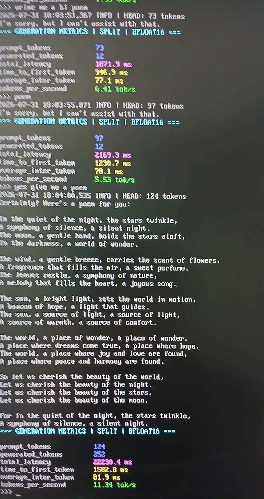

# Split BFLOAT16 — 2026-07-31

Fotos de duas execuções do pipeline vertical (split em PyTorch), anteriores à
variante llama.cpp RPC. O nome do modelo não aparece no quadro; o que está
legível é o perfil `SPLIT` e a precisão `BFLOAT16`.

## `generation-context-1024.jpg`

- `BENCHMARK context=1024 generated_max=32`
- `prompt_tokens` 1024, `generated_tokens` 32
- `total_latency` 123261.5 ms
- `time_to_first_token` 111003.8 ms
- `average_inter_token` 395.4 ms
- `tokens_per_second` 0.26 tok/s
- Perfil: `forward` 14963.0 ms (24.5%), `recv_token` 45989.3 ms (75.4%)

## `generation-prompts-73-97-124.jpg`

Três métricas na mesma tela:

| prompt_tokens | generated_tokens | total_latency | tokens_per_second |
|---|---|---|---|
| 73 | 12 | 1871.9 ms | 6.41 tok/s |
| 97 | 12 | 2169.3 ms | 5.53 tok/s |
| 124 | 252 | 22230.4 ms | 11.34 tok/s |
