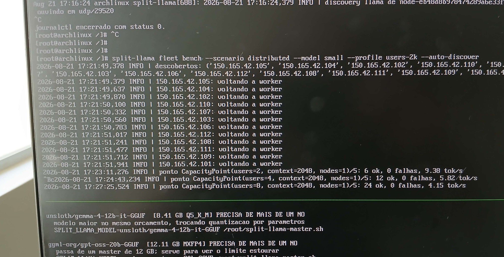
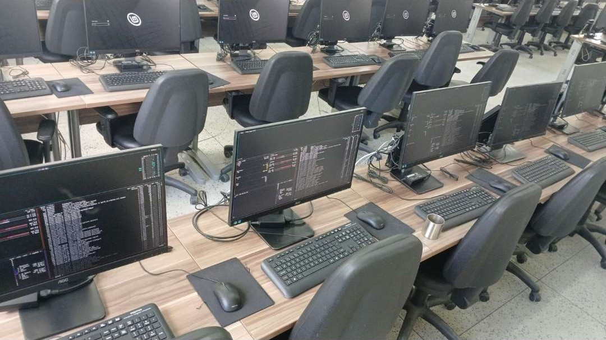

# Fleet bench em 12 nós — 2026-08-21

Execuções de `split-llama fleet bench` com autodiscovery em 12 nós
(`150.165.42.101` a `150.165.42.112`), perfil `small`, contexto 2048 e sem
`--usb-device`. O perfil `small` é o Qwen3.5-0.8B Q4_K_M da tabela de modelos
oficiais do `README-FLEET-BENCH.md`.

> **tok/s**: média por requisição, ponderada por tokens
> (`Σ tokens / Σ duração e2e` das requisições bem-sucedidas). Não é a vazão
> total da frota; a definição está em `README-FLEET-BENCH.md`.

## `distributed-users-2-4-8.jpg`



```text
split-llama fleet bench --scenario distributed --model small --profile users-2k --auto-discover
```

| usuários | requisições ok | falhas | tok/s |
|---|---|---|---|
| 2 | 6 | 0 | 9.38 |
| 4 | 12 | 0 | 5.82 |
| 8 | 24 | 0 | 4.15 |

## `replicated-users-2-32.jpg`


```text
split-llama fleet bench --scenario replicated --model small --profile users-2k --auto-discover
```

| usuários | requisições ok | falhas | tok/s |
|---|---|---|---|
| 2 | 6 | 0 | 24.95 |
| 4 | 12 | 0 | 26.39 |
| 8 | 24 | 0 | 24.58 |
| 16 | 48 | 0 | 22.48 |
| 32 | 96 | 0 | 18.13 |

Resumo gravado em `/run/split-models/benchmark-results/capacity-summary.csv`
(tmpfs, não persistido).

## `lab-cluster.jpg`



Foto do laboratório onde a frota física estava montada. Serve como contexto
das execuções; os terminais abertos nos monitores mostram a mesma sessão de
benchmark.
