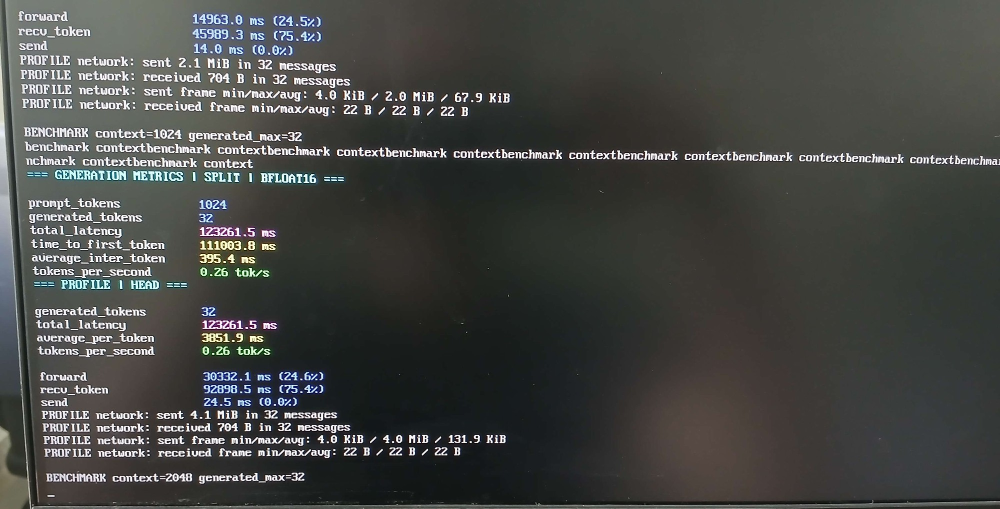
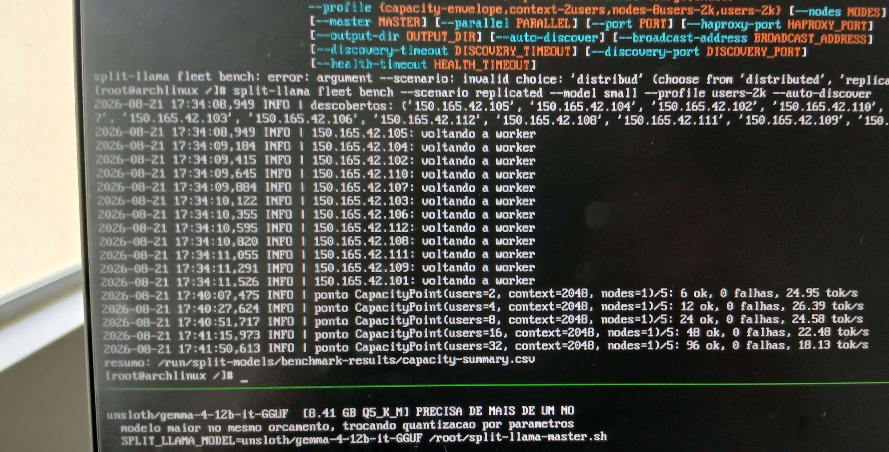

# Evidências fotográficas de execução

Fotos de tela tiradas pelo operador durante execuções reais do código deste
repositório. As imagens foram recortadas para remover moldura do monitor, fundo
e interface do mensageiro; o conteúdo do terminal não foi alterado. A única
transformação além do recorte é a redução para no máximo 2000 px no lado maior.

Nenhuma destas execuções usou `--usb-device`. Elas são anteriores à política de
cache USB documentada em `decisions/llamacpp-stateless-cache-policy.md`, quando
o modelo era baixado para `/run` (tmpfs) ou já estava em cache local.

## 2026-07-31 — split vertical em BFLOAT16

[Pasta](2026-07-31-split-bfloat16/) com duas fotos do pipeline vertical
(PyTorch), anterior à variante llama.cpp RPC.

## 2026-08-21 — fleet bench em 12 nós

[Pasta](2026-08-21-fleet-bench-12-nodes/) com duas fotos do
`split-llama fleet bench` nos cenários distribuído e replicado, além da foto do
laboratório.

## Limitações

- Os números são os exibidos na tela no momento da execução, não uma reanálise
  dos dados brutos.
- A coluna `tok/s` é a média por requisição, ponderada por tokens
  (`Σ tokens / Σ duração e2e`), não a vazão total da frota.
- Os CSVs originais ficaram em `/run/split-models/benchmark-results/`, que é
  tmpfs e não sobreviveu ao reboot.
- A foto de 2026-07-31 não mostra o nome do modelo; apenas o perfil `SPLIT` e a
  precisão `BFLOAT16`.
